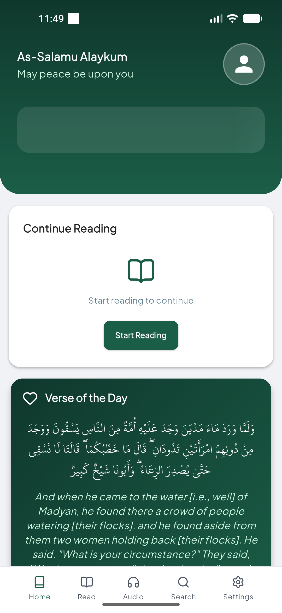
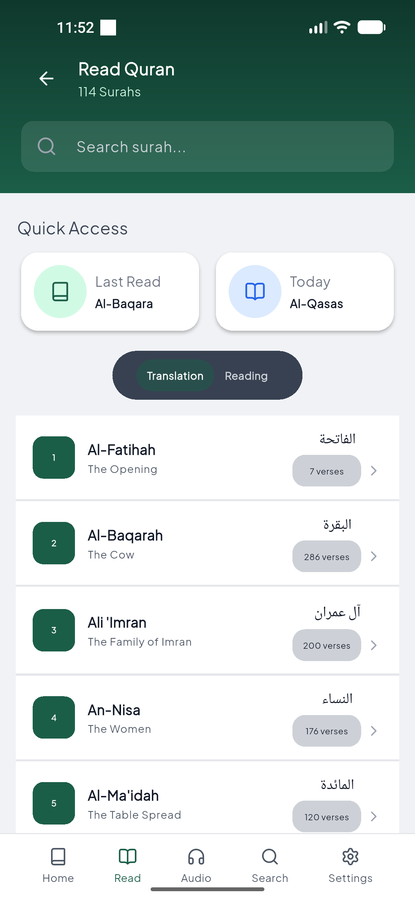
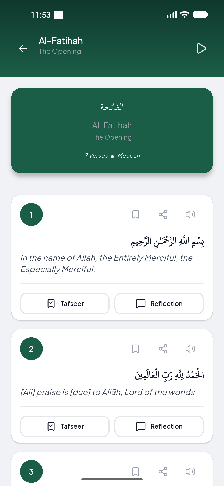
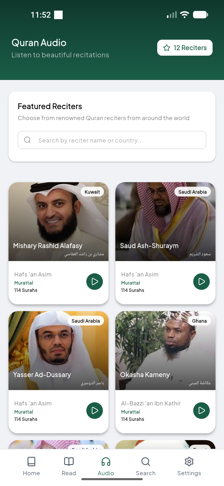
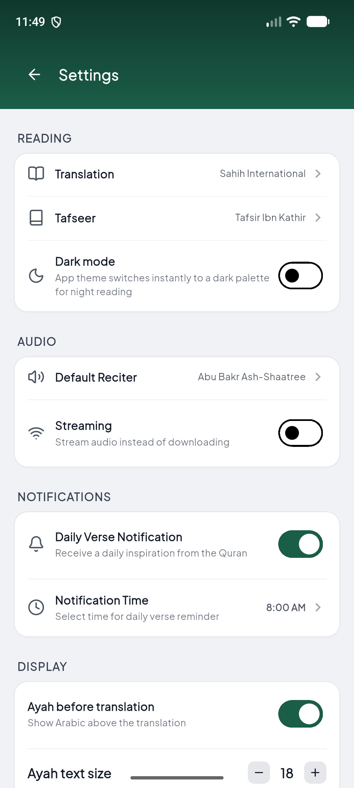
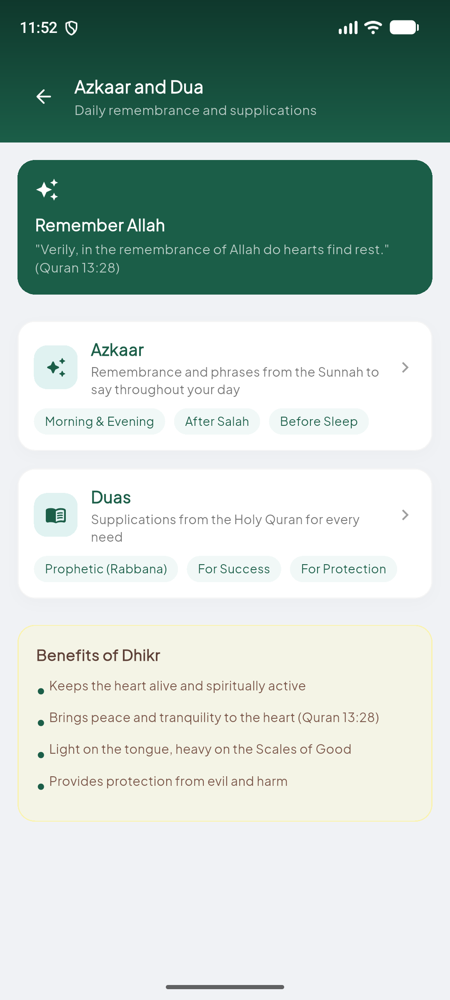
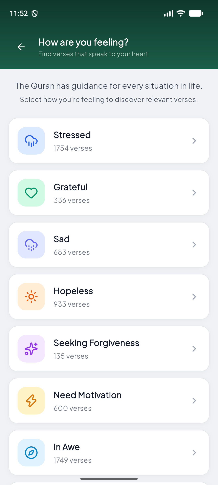
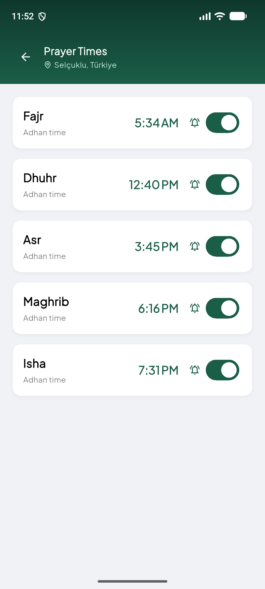
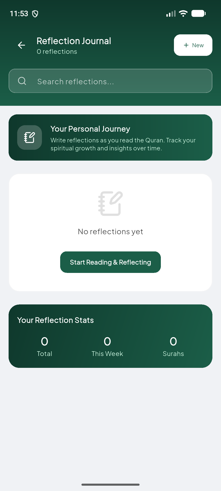
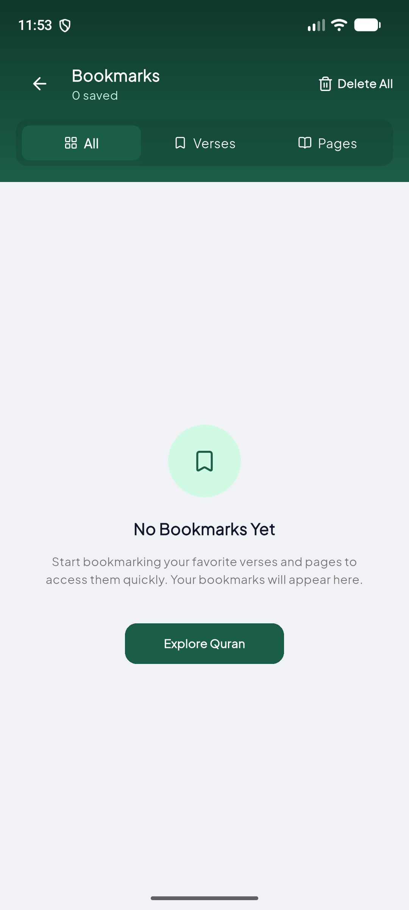

# Quran App

A Flutter Quran companion for reading, listening, and building a steady daily practice. The app brings Quran reading and recitation together with prayer times, duas and azkaar, bookmarks, reflections, and reading progress.

## At a glance

- **Read:** browse all 114 surahs, switch between translation and reading views, and open ayah details.
- **Listen:** explore reciters, stream recitation in the background, and download surahs for offline listening.
- **Learn and reflect:** access translations, tafseer, Quranic duas, azkaar, and topic-based guidance.
- **Keep your place:** save ayah and page bookmarks, write reflections, and track reading activity.
- **Make it yours:** choose display preferences, Quran script and text sizes, and manage audio downloads and storage.
- **Daily tools:** view location-based prayer times and reminders.

The app is local-first for reading and personal data. Quran-related reference data is bundled with the app, and bookmarks, reflections, settings, and reading progress are stored locally. **Cloud sync and account sign-in are not currently implemented.**

## Screenshots

Captured from the running Android app on an Android emulator.

<p align="center">
  
  &nbsp;
  
  &nbsp;
  
  &nbsp;
  
</p>

Additional views show settings, daily practice, guidance, and personal tools.

<p align="center">
  
  &nbsp;
  
  &nbsp;
  
  &nbsp;
  
</p>

<p align="center">
  
  &nbsp;
  
</p>

## Features

### Quran reading

- Surah browser with search and quick access to reading.
- Ayah-by-ayah and page-based reading experiences.
- Arabic Quran text with dedicated Quran fonts, translations, and tafseer options.
- Bookmarks for verses and pages, plus a continue-reading position.

### Recitation and downloads

- Reciter browser with search and reciter information.
- Background audio playback with playback controls.
- Stream recitation or download surahs for offline listening.
- Download and storage management.

### Daily practice and study

- Prayer times calculated for the user's location, with notification support.
- Quranic duas, duas, and azkaar.
- Daily verse, topic-based Quran guidance, and reflections on verses.
- Search, bookmarks, reading history, and progress views.

### Personalization

- Light and dark themes.
- Reading display options, including script and text-size preferences.
- Reciter and audio download settings.

## Built with

- **Flutter and Dart** for the app.
- **Riverpod** for state management and **GoRouter** for navigation.
- **just_audio** and **audio_service** for playback and background audio.
- **SQLite (`sqflite`)** for local app data.
- **Dio** for network requests and audio downloads.
- **adhan**, **geolocator**, and Flutter notifications packages for prayer-time features.
- Quran data/rendering packages and bundled Arabic fonts for the reading experience.

### Local database upgrades

The local SQLite database has a versioned upgrade callback and is currently at schema version 1. No schema migration is needed yet. When changing the schema, increment the version and add a migration for each new version in `DatabaseHelper._upgradeDB`. For example, adding a nullable `color` column to `bookmarks` in version 2 can use `ALTER TABLE bookmarks ADD COLUMN color TEXT`; SQLite keeps existing bookmark rows and their new `color` values are `NULL`. For a required column, choose a safe default for existing rows. The callback fails clearly if a version has no migration, rather than silently opening an unsupported schema. Test upgrades from a copy of a prior-version database before shipping.

## Project structure

```text
lib/
├── app/          # App widget and app-level setup
├── core/         # Shared database, routing, theme, notifications, and widgets
├── features/     # Feature-based app code
│   ├── audio/
│   ├── azkaar_and_dua/
│   ├── bookmark/
│   ├── find_guidance/
│   ├── prayer_times/
│   ├── progress/
│   ├── quran/
│   ├── reflection/
│   ├── search/
│   └── settings/
└── main.dart

assets/
├── database/     # Bundled translations, tafseer, duas, and guidance data
├── fonts/        # Arabic Quran and display fonts
├── metadata/     # Surah metadata
└── reciters/     # Reciter images
```

## Run the app

### Requirements

- Flutter SDK with Dart **3.10.4 or newer** (the Dart constraint is `^3.10.4`).
- A configured Android emulator or device for the Android experience.

### Setup

```bash
flutter pub get
flutter devices
flutter run
```

To run on a particular connected device, pass its ID from `flutter devices`:

```bash
flutter run -d <device-id>
```

## Checks

Run the project's static analysis and tests with:

```bash
flutter analyze
flutter test
```

The current `test/widget_test.dart` is still Flutter's starter counter test. It does not cover Quran reading, audio, bookmarks, prayer times, or other app workflows, so treat it as a placeholder rather than meaningful feature coverage.

## Data and privacy notes

- Reading reference data and personal app data are available locally; audio streaming requires a network connection.
- Downloaded recitation files are stored on the device and can be managed in the app.
- The app does not currently provide account-based cloud backup or cross-device synchronization.
- Data bundled with the app may have its own attribution or usage terms; see the in-app About and Credits pages.

## Developer

<p align="center">
  <br />
  <strong>AMTILYST</strong>
</p>
